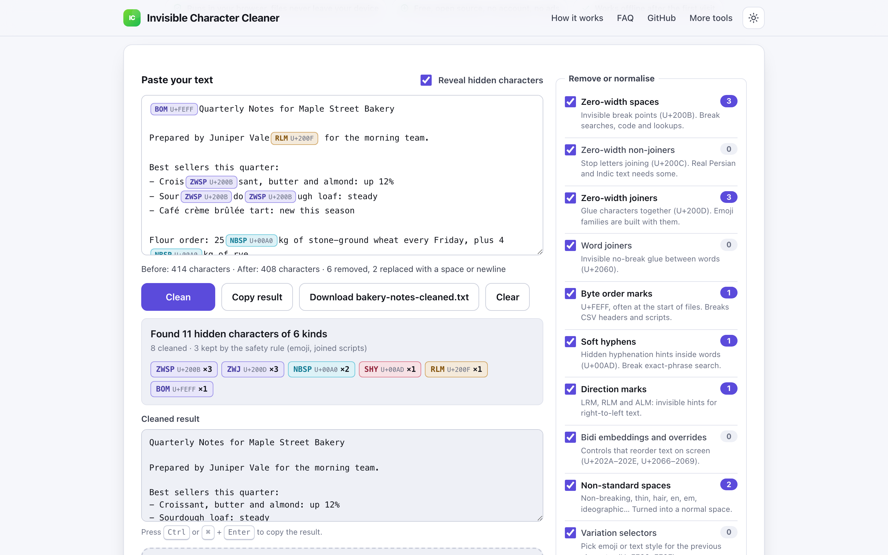
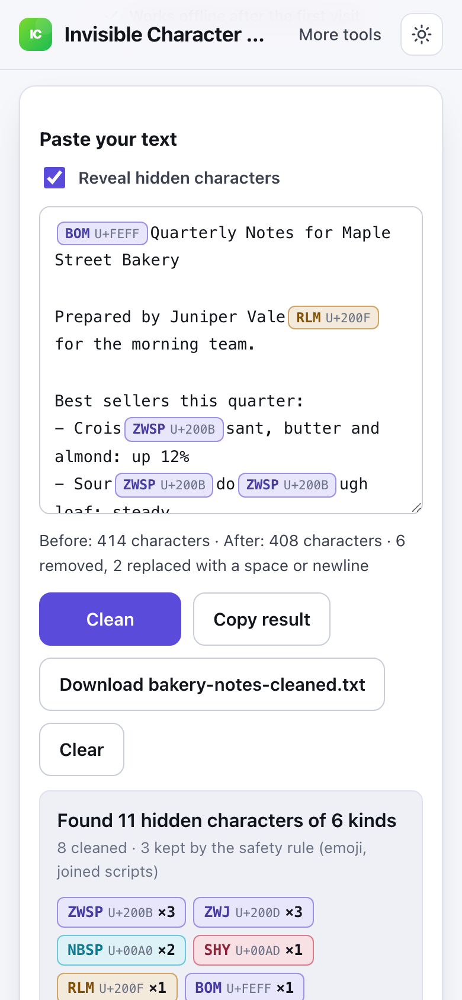

# Invisible Character Cleaner

> Find and remove zero-width spaces and hidden Unicode characters from pasted text in your browser, nothing uploaded.

**🌐 Use it now: [turhe123.github.io/invisible-character-cleaner](https://turhe123.github.io/invisible-character-cleaner/)** · free · open source · runs in your browser · works offline


## Why

Text pasted from AI chatbots, PDFs, web pages and Word documents often carries invisible Unicode: zero-width spaces, byte order marks, soft hyphens, direction marks and exotic spaces. They make code fail to compile, exact-phrase searches miss, and spreadsheet lookups not match. Invisible Character Cleaner is a free, open-source alternative to Originality.ai Invisible Text Detector and DevToolLab Invisible Character Remover. Those are ad-supported pages where you paste text into a site with unclear processing, and most tools strip everything blindly, which breaks emoji and accented or joined scripts. Here your text never leaves the device, there is no account, no ads and no limits, it works offline, and it can be installed as an app.

## Screenshots

<p align="center"></p>

<p align="center"><em>Invisible Character Cleaner in the browser, light theme</em></p>

<p align="center"></p>

<p align="center"><em>Invisible Character Cleaner on a phone</em></p>

## Features

- Detects hidden characters in one pass over the text and lists every kind found, with a count per category.
- Categories, each of which can be switched on or off: zero-width space, zero-width non-joiner, zero-width joiner, word joiner, byte order mark, soft hyphen, left-to-right and right-to-left marks, bidirectional embeddings, overrides and isolates, variation selectors, invisible tag characters, other control characters (tabs and newlines are always kept), and non-standard spaces (non-breaking, thin, hair, en, em, narrow no-break and ideographic).
- Exotic spaces are replaced with a normal space instead of deleted, so words stay separated.
- Safety option (on by default): keeps zero-width joiners inside emoji sequences and next to Arabic or Indic letters, variation selectors after emoji, and flag tag sequences. Accented letters are never touched.
- Reveal view: swaps the editor for a read-only view where each hidden character is a labelled chip with its short name and code point (for example ZWSP, U+200B). Chips show whether a character will be removed, replaced or kept. The view is built with DOM text nodes, not innerHTML, and is capped at 300,000 characters (the counts and result still cover the whole text).
- Optional extras, off by default: trim trailing spaces on each line, collapse repeated spaces, normalise line endings to LF.
- Live cleaning as you type, paste or change options, with a before/after character count.
- A warning when right-to-left text is present and direction marks would be removed, since this may change display order.
- A clear "already clean" message when nothing hidden is found.
- Copy the result (Ctrl or Cmd + Enter, with a fallback for Safari) or download it as `cleaned.txt`, or as `original-name-cleaned.ext` when a file was loaded.
- Load a fictional sample text with one click.
- Large inputs (over about 1.5 million characters) are cleaned in a Web Worker with a progress bar so the page stays responsive.
- Keyboard accessible, light and dark themes, layout checked at 390px wide.
- Installable and works offline through a service worker.

**Input:** pasted text, or a dropped or chosen text file (.txt, .md, .csv, .tsv, .json, .jsonl, .log, .srt, .vtt, .yaml, .xml, .html, .css and common source code extensions). Files must be valid UTF-8, and UTF-16 files are rejected with a clear message.
**Output:** cleaned text in the page, copied to the clipboard, or downloaded as a UTF-8 text file.
**Limits:** files up to 20 MB, one file at a time.

## How to use

1. Paste your text into the box, drop a text file, or click "Load the sample text".
2. Read the report: each type of hidden character is listed with a count. Turn on "Reveal hidden characters" to see exactly where each one sits.
3. Untick any category you want to keep, and adjust the safety option and extras if needed. The result updates live.
4. Click "Copy result" (or press Ctrl or Cmd + Enter), or "Download cleaned.txt".

## Privacy

- Nothing is uploaded. Pasted text and files are read into memory on your device and cleaned with JavaScript.
- No cookies, and nothing is stored.
- Page views are counted anonymously with [GoatCounter](https://www.goatcounter.com/), which is cookieless and open source. It is the only network request the page makes besides its own files.
- After the first visit, a service worker caches the page so it works offline.

## Run it locally

```sh
git clone https://github.com/turhe123/invisible-character-cleaner
cd invisible-character-cleaner
python3 -m http.server 4173
```

Then open http://127.0.0.1:4173/. There is no build step.

## Tests

```sh
npm i -D @playwright/test && npx playwright install chromium
npx playwright test
```

## Third-party code

None: browser APIs only.

## Built with AI

Invisible Character Cleaner was written by [Claude Code](https://claude.com/claude-code) inside an automated pipeline, from a plain-English spec. No code or assets from any commercial product were used; it is a clean-room implementation of a feature set, not a copy.

What that means in practice:

- The full source is in this repo under the MIT license. Read it before you trust it with your files.
- Everything runs in your browser. It makes no network requests except an anonymous, cookieless page-view count (GoatCounter); your files never leave the device.
- The page is tested headless in Chromium (Playwright) before every release, but it has had less human review than hand-written software. Bug reports and pull requests are welcome.

## Support ❤️

If this saved you time or a subscription, you can support the project on [Ko-fi](https://ko-fi.com/leodavidai).

## More free web tools

Browse the rest at [turhe123.github.io/web-tools](https://turhe123.github.io/web-tools/).

Also: [free, open-source Mac apps](https://turhe123.github.io/mac-apps/) built the same way, native Swift, no accounts, no telemetry.

## License

MIT © Or Davidai Bachar
